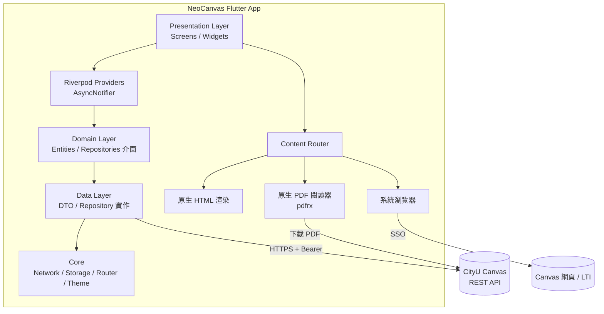
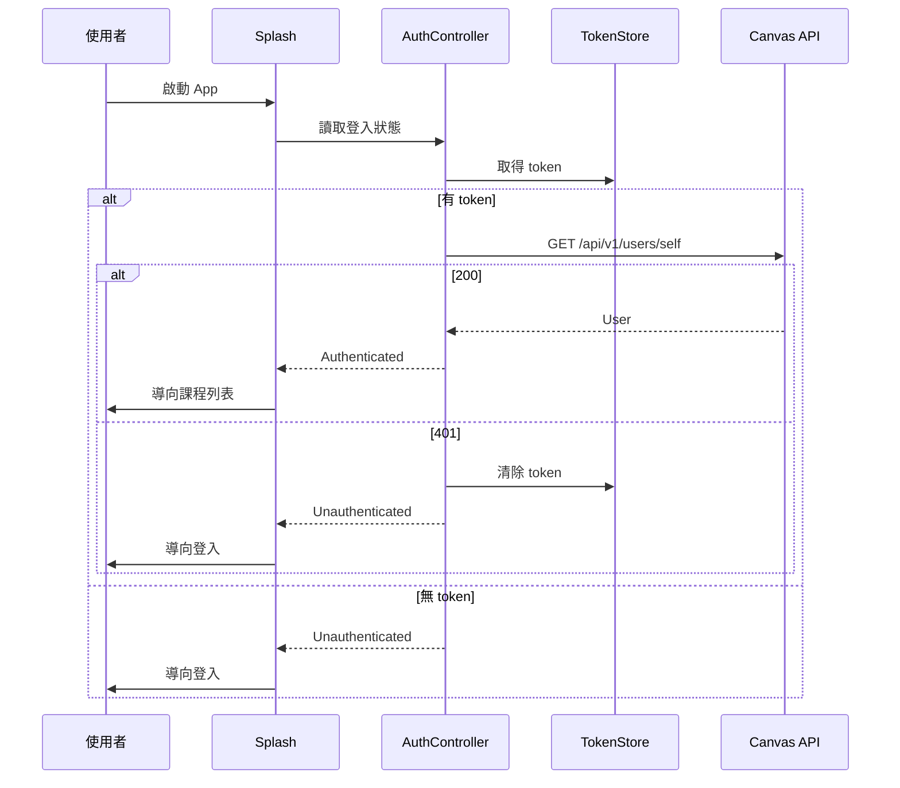
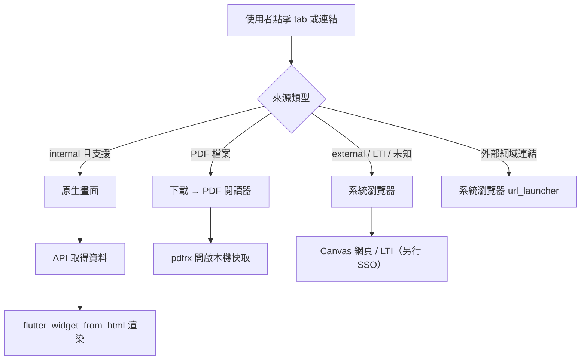
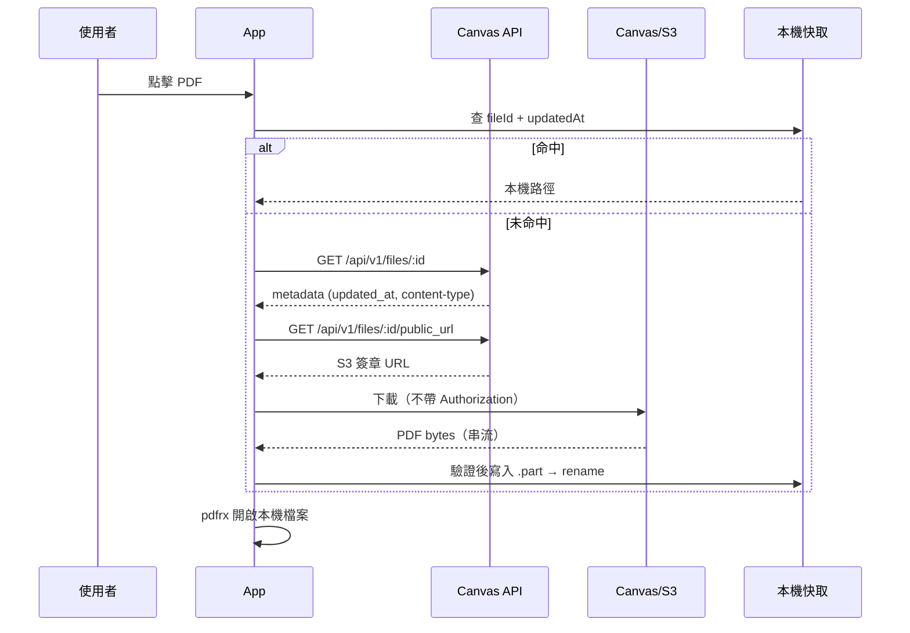

# NeoCanvas 架構文件

> 版本：0.3
> 狀態：MVP 已實作（Windows / Android）
> 最後更新：2026-10-29（同步實作現況、移除本機路徑）
> 目標讀者：NeoCanvas 開發者、維護者

---

## 目錄

1. [專案概述](#1-專案概述)
2. [需求範圍](#2-需求範圍)
3. [平台與技術棧](#3-平台與技術棧)
4. [系統總覽](#4-系統總覽)
5. [分層架構](#5-分層架構)
6. [目錄結構](#6-目錄結構)
7. [核心模組設計](#7-核心模組設計)
8. [資料模型](#8-資料模型)
9. [Canvas API 對應](#9-canvas-api-對應)
10. [狀態管理規範](#10-狀態管理規範)
11. [網路層設計](#11-網路層設計)
12. [認證與安全性](#12-認證與安全性)
13. [內容渲染雙軌架構](#13-內容渲染雙軌架構)
14. [平台差異](#14-平台差異)
15. [UI/UX 與響應式設計](#15-uiux-與響應式設計)
16. [錯誤處理](#16-錯誤處理)
17. [效能策略](#17-效能策略)
18. [測試策略](#18-測試策略)
19. [建置與發佈](#19-建置與發佈)
20. [開發規範](#20-開發規範)
21. [里程碑](#21-里程碑)
22. [風險與對策](#22-風險與對策)
23. [待確認事項](#23-待確認事項)
24. [PDF 子系統](#24-pdf-子系統)
25. [附錄](#25-附錄)

---

## 1. 專案概述

### 1.1 背景

CityU 目前使用的 Canvas LMS 用戶端（官方 app 與行動網頁）在功能與效能上都偏臃腫：載入慢、資訊層級混亂、桌面體驗不足。NeoCanvas 的目的是提供一個**輕量、快速、以課程為中心**的替代用戶端。

### 1.2 目標

- 以 Flutter 單一程式碼庫支援 **Windows 桌面 + Android**，之後擴充 iOS。
- 提供比官方更快的課程瀏覽體驗：開啟即見課程列表，課程首頁一鍵可達。
- 保持與 Canvas REST API 完整相容，不自行複製學校資料。
- 架構可擴充：MVP 做課程列表、課程首頁與原生 PDF 閱讀器，模組邊界要能承接作業、成績、模組、檔案等後續功能。
- 解決 Canvas 原生 PDF 體驗不佳的痛點：原生渲染、本機快取、搜尋與目錄。

### 1.3 非目標（Non-goals）

- **不**自行實作 LTI 工具（Panopto、Turnitin、New Quizzes）。目前以系統瀏覽器開啟；內嵌 WebView 列為 Backlog。
- **不**建立離線資料庫快取（本版決策）；但 PDF 等檔案的按需下載快取不在此限（見第 24 節）。
- **不**實作推播通知（本版決策）。
- **不**代理或儲存學校帳密；認證僅使用 Canvas Personal Access Token。
- **不**支援 Web 平台（現階段）。

### 1.4 名詞定義

| 名詞 | 說明 |
|---|---|
| PAT | Personal Access Token，Canvas 使用者自行產生的 API 權杖 |
| LTI | Learning Tools Interoperability，Canvas 的外部工具協定 |
| SSO | Single Sign-On，CityU 的 AIMS 登入流程 |
| Tab | Canvas 課程導覽項目（Home、Modules、Grades、外部工具等） |
| DTO | Data Transfer Object，對應 API JSON 的資料結構 |
| Entity | 領域實體，商業邏輯使用的資料結構 |

---

## 2. 需求範圍

### 2.1 MVP（第一版）

| 編號 | 功能 | 說明 |
|---|---|---|
| F1 | PAT 登入 | 輸入 Canvas 網域與 token，驗證後保存 |
| F2 | 登出 | 清除 token 與 PDF 快取 |
| F3 | 課程列表 | 取得使用者 active 課程，分學期群組、最愛置頂、搜尋 |
| F4 | 課程首頁 | 課程標頭、老師、學期、tabs、依 `default_view` 呈現內容 |
| F5 | 原生內容渲染 | syllabus / front page 等 HTML 以原生 widget 顯示 |
| F6 | 外部工具入口 | `type=external` tab 以系統瀏覽器開啟（內嵌 WebView/SSO 列為 Backlog） |
| F7 | 基本錯誤/載入/空狀態 | 網路錯誤、401、429、空列表 |
| F8 | 主題 | Material 3、亮/暗/跟隨系統 |
| F9 | PDF 閱讀器 | 課程內 PDF 以原生渲染，支援翻頁、記住頁碼與下載進度（搜尋/目錄/深色列為 Backlog） |
| F10 | 檔案快取 | PDF 首次下載後本機快取（LRU），登出預設清除 |

### 2.2 後續版本（Backlog）

- WebView + SSO 內嵌外部工具
- PDF 搜尋、選取、目錄、縮圖、深色閱讀、列印/分享
- 作業列表與提交（含檔案上傳）
- 成績總覽與 what-if
- Modules / Pages 瀏覽與下載（PDF 已在 MVP）
- 行事曆、Planner、待辦
- 討論區、公告、Inbox
- 多帳號 / 多學校網域
- 離線快取與背景同步
- 推播通知
- iOS 平台

### 2.3 驗收條件（MVP）

- 使用者能在 Windows 與 Android 上以 PAT 登入並看到自己的課程。
- 課程列表依學期分組，最愛課程置頂，可即時搜尋。
- 點進課程能看到 tabs；syllabus 與 front page 以原生方式顯示。
- 點擊外部工具 tab 能開啟系統瀏覽器。
- 課程內的 PDF 能以原生閱讀器開啟，支援翻頁與記住頁碼。
- 同一 PDF 第二次開啟不需重新下載。
- token 只存於平台安全儲存，不寫入日誌。
- `flutter analyze` 無錯誤、核心邏輯有單元測試。

---

## 3. 平台與技術棧

### 3.1 平台優先序

1. Windows（桌面，主要開發平台）
2. Android（行動）
3. iOS（第二階段）
4. Web（不支援）

### 3.2 技術棧

| 類別 | 套件 / 技術 | 用途 | 備註 |
|---|---|---|---|
| SDK | Flutter stable | UI 框架 | 需 3.47+（pdfrx 需求） |
| 語言 | Dart 3.x | — | 使用 sealed class、pattern matching |
| 狀態管理 | `flutter_riverpod` | 依賴注入與狀態 | 手寫 provider；`riverpod_annotation` 依賴已預留 |
| 路由 | `go_router` | 宣告式路由 | 支援深層連結 |
| HTTP | `dio` | API 請求 | interceptor |
| 模型 | 手寫不可變模型 | JSON 解析 | `freezed` / `json_serializable` 依賴已預留 |
| 安全儲存 | `flutter_secure_storage` | PAT | Windows/Android |
| 偏好設定 | `shared_preferences` | base URL、主題 | 非敏感 |
| HTML | `flutter_widget_from_html` | syllabus/front page | 連結攔截 |
| PDF 渲染 | `pdfrx` | 原生 PDF 閱讀器 | PDFium；Windows 需 Developer Mode |
| 快取路徑 | `path_provider` | 下載/快取目錄 | |
| 分享 | `share_plus` | 預留 | 尚未接 UI |
| 開外部連結 | `url_launcher` | 系統瀏覽器 | |
| 圖片 | `cached_network_image` | 預留 | 尚未接 UI |
| 時間格式 | `intl` | 學期、日期 | |
| 日誌 | `logger` | 除錯 | 需遮蔽 token |
| Lint | `flutter_lints` | 靜態檢查 | |
| 測試 | `flutter_test`, `http_mock_adapter` | 單元/widget | 目前以單元測試為主 |

### 3.3 套件選擇原則

- 優先選社群活躍、支援 Windows 且無原生 C++ 客製需求的套件。
- PDF 渲染是目前唯一的平台相關模組；WebView 列為 Backlog。
- PDF 選 `pdfrx` 而非 `pdfx`：需要文字搜尋、選取、目錄與漸進載入（UI 尚未全部實作）。
- 避免引入大型 state/DI 框架（如 get_it + bloc 全套）造成樣板化。

---

## 4. 系統總覽



### 4.1 資料流

1. UI 呼叫 Riverpod provider。
2. Provider 呼叫 data 層的 repository。
3. Repository 透過 Dio 打 Canvas API。
4. JSON 經 model 的 `fromJson` 轉為 domain model，回傳給 provider。
5. Provider 以 `AsyncValue` 通知 UI 更新。

### 4.2 身分雙軌

- **API 身分**：PAT → `Authorization: Bearer`，用於所有 `/api/v1` 請求。
- **網頁身分**：系統瀏覽器內的 CityU SSO session，用於 LTI 與外部工具（內嵌 WebView 列為 Backlog）。
- 兩者互相獨立，UI 必須明確告知使用者。

---

## 5. 分層架構

### 5.1 層級與依賴規則

```
presentation  →  domain  ←  data
      │                        │
      └──────── core ──────────┘
```

- `presentation` 透過 Riverpod provider 取得資料，不直接建立 Dio。
- `domain` 目前只有 model（純 Dart，不依賴 Flutter）。
- `data` 提供具體 repository，負責 API 呼叫與 JSON 解析。
- `core` 提供跨 feature 的基礎設施（網路、儲存、路由、主題）。
- Feature 之間不直接互相依賴；共用邏輯下沉到 `core` 或 `shared`。

### 5.2 為什麼不用完整 Clean Architecture

MVP 沒有 use case 類別。策略：

- 簡單讀取（課程列表）→ Provider 直接呼叫 Repository。
- 流程邏輯（登入驗證）放在 `AuthController`。
- 內容分類（tab/URL）放在 `core/content`。
- 日後可再補 use case。

---

## 6. 目錄結構

```text
NeoCanvas/
├─ android/
├─ windows/
├─ docs/
│  └─ ARCHITECTURE.md
├─ lib/
│  ├─ main.dart
│  ├─ app.dart
│  ├─ core/
│  │  ├─ config/
│  │  │  └─ app_config.dart
│  │  ├─ content/
│  │  │  └─ content_route.dart
│  │  ├─ network/
│  │  │  ├─ api_exception.dart
│  │  │  ├─ auth_interceptor.dart
│  │  │  ├─ error_interceptor.dart
│  │  │  ├─ pagination.dart
│  │  │  └─ token_store.dart
│  │  ├─ router/
│  │  │  └─ app_router.dart
│  │  ├─ theme/
│  │  │  ├─ app_theme.dart
│  │  │  └─ course_palette.dart
│  │  ├─ utils/
│  │  │  └─ url_utils.dart
│  │  └─ providers.dart
│  ├─ features/
│  │  ├─ auth/
│  │  │  ├─ data/
│  │  │  │  └─ auth_repository.dart
│  │  │  ├─ domain/
│  │  │  │  └─ user.dart
│  │  │  └─ presentation/
│  │  │     ├─ auth_controller.dart
│  │  │     ├─ login_screen.dart
│  │  │     └─ splash_screen.dart
│  │  ├─ courses/
│  │  │  ├─ data/
│  │  │  │  └─ courses_repository.dart
│  │  │  ├─ domain/
│  │  │  │  └─ course.dart
│  │  │  └─ presentation/
│  │  │     ├─ course_row.dart
│  │  │     ├─ courses_providers.dart
│  │  │     └─ courses_screen.dart
│  │  ├─ course_home/
│  │  │  ├─ data/
│  │  │  │  └─ course_home_repository.dart
│  │  │  ├─ domain/
│  │  │  │  └─ course_page.dart
│  │  │  └─ presentation/
│  │  │     ├─ course_home_providers.dart
│  │  │     └─ course_home_screen.dart
│  │  ├─ files/
│  │  │  ├─ data/
│  │  │  │  ├─ files_repository.dart
│  │  │  │  └─ pdf_cache_service.dart
│  │  │  ├─ domain/
│  │  │  │  └─ course_file.dart
│  │  │  └─ presentation/
│  │  │     ├─ files_pane.dart
│  │  │     ├─ files_providers.dart
│  │  │     └─ files_screen.dart
│  │  ├─ pdf_viewer/
│  │  │  └─ presentation/
│  │  │     └─ pdf_viewer_screen.dart
│  │  └─ settings/
│  │     └─ presentation/
│  │        └─ settings_screen.dart
│  └─ shared/
│     └─ widgets/
│        ├─ app_scaffold.dart
│        ├─ async_value_view.dart
│        ├─ empty_view.dart
│        ├─ error_view.dart
│        └─ skeleton.dart
├─ test/
│  └─ unit/
│     ├─ course_grouping_test.dart
│     ├─ pagination_test.dart
│     └─ url_utils_test.dart
├─ analysis_options.yaml
├─ pubspec.yaml
├─ README.md
└─ LICENSE
```

### 6.1 命名規則

- 檔案：`snake_case.dart`
- 類別：`PascalCase`
- 目前沒有 DTO 層；model 直接放在 `domain`
- Provider 後綴 `Provider`，Notifier 後綴 `Controller`
- 畫面後綴 `Screen`，可重用元件用語意名稱

---

## 7. 核心模組設計

### 7.1 Bootstrap

`main.dart` 初始化 `SharedPreferences`，再以 `ProviderScope` 覆寫 `sharedPreferencesProvider`：

```dart
Future<void> main() async {
  WidgetsFlutterBinding.ensureInitialized();
  final preferences = await SharedPreferences.getInstance();
  runApp(
    ProviderScope(
      overrides: [
        sharedPreferencesProvider.overrideWithValue(preferences),
      ],
      child: const NeoCanvasApp(),
    ),
  );
}
```

沒有 `bootstrap.dart`；其餘初始化由 Riverpod provider 負責。

### 7.2 依賴注入（Riverpod）

| Provider | 型別 | 說明 |
|---|---|---|
| `sharedPreferencesProvider` | `Provider<SharedPreferences>` | 偏好設定（main 覆寫） |
| `tokenStoreProvider` | `Provider<TokenStore>` | PAT 記憶體與安全儲存 |
| `baseUrlProvider` | `NotifierProvider<BaseUrlController, String>` | Canvas 網域 |
| `themeModeProvider` | `NotifierProvider<ThemeModeController, ThemeMode>` | 主題 |
| `dioProvider` | `Provider<Dio>` | HTTP client |
| `authRepositoryProvider` | `Provider<AuthRepository>` | 使用者驗證 |
| `authControllerProvider` | `NotifierProvider<AuthController, AuthState>` | 登入狀態 |
| `coursesRepositoryProvider` | `Provider<CoursesRepository>` | 課程 API |
| `coursesProvider` | `FutureProvider<List<Course>>` | 課程列表 |
| `courseSearchProvider` | `NotifierProvider<CourseSearchController, String>` | 課程搜尋字串 |
| `selectedCourseIdProvider` | `NotifierProvider<SelectedCourseController, int?>` | 桌面選取課程 |
| `courseHomeRepositoryProvider` | `Provider<CourseHomeRepository>` | 課程首頁 API |
| `courseDetailProvider(id)` | `FutureProvider.family<Course, int>` | 單一課程 |
| `courseTabsProvider(id)` | `FutureProvider.family<List<CourseTab>, int>` | 可見 tabs |
| `frontPageProvider(id)` | `FutureProvider.family<CoursePage?, int>` | front page |
| `filesRepositoryProvider` | `Provider<FilesRepository>` | 檔案 API |
| `filesProvider(courseId)` | `FutureProvider.family<List<CourseFile>, int>` | 課程 PDF 列表 |
| `fileDetailProvider(request)` | `FutureProvider.family<CourseFile, FileRequest>` | 單一檔案 |
| `pdfCacheServiceProvider` | `Provider<PdfCacheService>` | 下載與快取 |

目前使用手寫 provider；`riverpod_generator` 依賴已預留但未啟用。

### 7.3 路由

| 路徑 | 畫面 | 說明 |
|---|---|---|
| `/splash` | SplashScreen | 檢查 token |
| `/login` | LoginScreen | PAT 輸入 |
| `/courses` | CoursesScreen | 課程列表（寬螢幕三欄） |
| `/courses/:courseId` | CourseHomeScreen | 課程首頁 |
| `/courses/:courseId/files` | FilesScreen | 課程檔案（MVP 只列 PDF） |
| `/courses/:courseId/files/:fileId` | PdfViewerScreen | 原生 PDF 閱讀器 |
| `/settings` | SettingsScreen | 設定 |

`app_router.dart` 使用 `redirect` 與 `refreshListenable`：

- `AuthUnknown` 且非 `/splash` → `/splash`
- `AuthUnauthenticated` 且非 `/login` → `/login`
- `AuthAuthenticated` 且在 `/login` 或 `/splash` → `/courses`

外部工具不再走 App 內路由，直接以系統瀏覽器開啟。

### 7.4 認證流程



登入畫面需包含「如何取得 PAT」的步驟說明：

1. 登入 Canvas 網頁版
2. Account → Settings
3. Approved Integrations → + New Access Token
4. 複製 token 貼上

### 7.5 課程列表

- 一次抓取 `per_page=100`，若超過則依 Link header 續抓（MVP 通常 <100）。
- 群組順序：
  1. 最愛（`favorite == true`）
  2. 依學期（`term.name`）新到舊
  3. 無學期課程置底
- 搜尋：對 `name`、`course_code`、老師名稱做本地前綴/包含比對。
- 排序：最愛 → 學期 → 課程名稱。

### 7.6 課程首頁

1. `GET /api/v1/courses/:id?include[]=syllabus_body&include[]=teachers&include[]=term&include[]=tabs`
2. 顯示課程標頭（名稱、代碼、學期、老師）。
3. 依 `tabs`（隱藏 `hidden == true`）建立導覽。
4. 依 `default_view` 決定首頁內容：

| `default_view` | 呈現 |
|---|---|
| `syllabus` | 原生渲染 `syllabus_body` |
| `wiki` | 取得 `front_page.body` 原生渲染 |
| `modules` | fallback：syllabus（若有）或空狀態 |
| `assignments` | fallback：syllabus（若有）或空狀態 |
| `feed` | fallback：syllabus（若有）或空狀態 |

> MVP 只完整支援 `syllabus` 與 `wiki`；其他 default_view 會 fallback 到 syllabus 或空狀態，tabs 仍可切換。

### 7.7 內容路由（Content Router）

```dart
enum TabKind {
  home, syllabus, modules, assignments, pages, files,
  grades, discussions, announcements, quizzes, external, unsupported,
}

TabKind classifyTab({required String id, required String type}) { ... }
```

規則：

- 檔案 URL（`/files/:id`、`/courses/:id/files/:id`、`/preview`、`?wrap=1`）→ PDF 閱讀器
- `type == 'external'` 或 id 前綴為 `context_external_tool_` / `nav_menu_link_` → 系統瀏覽器
- 其餘 internal tab：`home` / `syllabus` / `files` 有原生畫面，其他顯示「尚未支援」+ 瀏覽器入口
- 未分類 → `unsupported`

### 7.8 URL 正規化

- `/courses/1` → `{baseUrl}/courses/1`
- `http(s)://...` → 原樣
- `mailto:`、`tel:` → 交給 `url_launcher`
- Canvas 檔案 URL → 解析出 `fileId`/`courseId`，交給 PDF 閱讀器或檔案下載
- 相對路徑一律以 `baseUrl` 為基底

### 7.9 外部工具（Backlog）

目前未實作內嵌 WebView。`type=external` 與 LTI 工具以下列方式處理：

- 以 `url_launcher` 開系統瀏覽器
- 使用者需在瀏覽器自行完成 CityU SSO
- App 內不保存網頁 session

若之後要內嵌，需另外處理：

- Android：`flutter_inappwebview`
- Windows：`webview_windows`（WebView2 Runtime）
- WebView 登入、cookie、跨網域導覽與登出清理

---

## 8. 資料模型

### 8.1 領域實體

```dart
class User {
  final int id;
  final String name;
  final String? shortName;
  final String? avatarUrl;
  final String? primaryEmail;
}

class Course {
  final int id;
  final String name;
  final String courseCode;
  final String workflowState;
  final String? defaultView;
  final bool isFavorite;
  final Term? term;
  final List<Teacher> teachers;
  final Enrollment? selfEnrollment;
  final String? courseImageUrl;
  final String? syllabusBody;
  final List<CourseTab> tabs;
}

class Term {
  final int id;
  final String name;
  final DateTime? startAt;
  final DateTime? endAt;
}

class Teacher {
  final int id;
  final String displayName;
  final String? avatarUrl;
}

class Enrollment {
  final String type;
  final String role;
  final double? currentScore;
  final double? finalScore;
  final String? currentGrade;
  final String? finalGrade;
}

class CourseTab {
  final String id;
  final String label;
  final String htmlUrl;
  final String type;
  final bool hidden;
  final String visibility;
  final int position;
}

class CoursePage {
  final String url;
  final String title;
  final String body;
  final DateTime? updatedAt;
}

class CourseFile {
  final int id;
  final int? courseId;
  final String displayName;
  final String filename;
  final String contentType;
  final String mimeClass;
  final int size;
  final DateTime? updatedAt;
  final bool lockedForUser;
  final String? url;
}
```

### 8.2 JSON 解析

- 目前直接在 domain model 以手寫 `fromJson` 解析，沒有獨立 DTO/mapper。
- 欄位缺漏以預設值處理，時間使用 `DateTime.tryParse`。
- `freezed` / `json_serializable` 依賴已預留，尚未啟用。
- presentation 只接觸 domain model。

### 8.3 注意事項

- Canvas ID 為 64-bit integer；Dart native int 為 64-bit，安全。
- 時間為 ISO 8601 UTC，轉為本地時區顯示。
- `enrollments` 內的分數需要 `include[]=total_scores` 才會有。

---

## 9. Canvas API 對應

Base URL：`https://canvas.cityu.edu.hk`（可自訂）

| 功能 | Method | Endpoint | 參數 |
|---|---|---|---|
| 驗證 token | GET | `/api/v1/users/self` | — |
| 課程列表 | GET | `/api/v1/courses` | `enrollment_state=active`, `include[]=term`, `include[]=teachers`, `include[]=favorites`, `include[]=total_scores`, `include[]=course_image`, `per_page=100` |
| 單一課程 | GET | `/api/v1/courses/:id` | `include[]=syllabus_body`, `include[]=teachers`, `include[]=term`, `include[]=tabs` |
| 課程 tabs | GET | `/api/v1/courses/:id/tabs` | — |
| 首頁 (front page) | GET | `/api/v1/courses/:id/front_page` | — |
| 模組 | GET | `/api/v1/courses/:id/modules` | `include[]=items`, `per_page=100` |
| 作業 | GET | `/api/v1/courses/:id/assignments` | `per_page=100` |
| 頁面列表 | GET | `/api/v1/courses/:id/pages` | `per_page=100` |
| 單一頁面 | GET | `/api/v1/courses/:id/pages/:url` | — |
| 檔案列表 | GET | `/api/v1/courses/:id/files` | `per_page=100`；前端以 `mime_class`/`content-type`/副檔名篩 PDF |
| 檔案 metadata | GET | `/api/v1/files/:id` | — |
| 下載檔案 | GET | `/courses/:id/files/:id/download` | `download_frd=1` |
| 簽章下載 URL | GET | `/api/v1/files/:id/public_url` | 備援，回 S3 簽章 URL |
| 我的最愛課程 | GET | `/api/v1/users/self/favorites/courses` | — |

> MVP 已使用：`users/self`、`courses`、`courses/:id`、`front_page`、`tabs`、`files`、`files/:id`、`public_url`、`download`。其餘端點為 Backlog。

### 9.1 請求標頭

```http
Authorization: Bearer <token>
Accept: application/json
```

可選：`Accept: application/json+canvas-string-ids`（若日後支援 Web 平台）。

### 9.2 分頁

Canvas 以 `Link` header 回應：

```http
Link: <https://canvas.example/api/v1/courses?page=2&per_page=100>; rel="next",
      <https://canvas.example/api/v1/courses?page=1&per_page=100>; rel="current",
      <https://canvas.example/api/v1/courses?page=1&per_page=100>; rel="first"
```

實作：解析 `rel="next"`，跟隨直到不存在。

### 9.3 限流（Throttling）

- Canvas 可能回 `403 Rate Limit Exceeded` 或 `429`，附 `Retry-After`。
- 目前未實作自動重試；遇到 429/403 時顯示稍後再試（Backlog）。
- 避免同時發出大量請求；同一課程的資料以 provider 快取。

---

## 10. 狀態管理規範

### 10.1 使用型別

| 情境 | 型別 |
|---|---|
| 同步依賴 | `Provider` |
| 非同步一次性讀取 | `FutureProvider` |
| 可變狀態 + 方法 | `NotifierProvider` |
| 依參數查詢 | `FutureProvider.family` |

### 10.2 UI 與 AsyncValue

```dart
final asyncCourses = ref.watch(coursesProvider);

return asyncCourses.when(
  data: (courses) => CoursesList(courses: courses),
  loading: () => const CourseListSkeleton(),
  error: (e, st) => ErrorView(
    error: e,
    onRetry: () => ref.invalidate(coursesProvider),
  ),
);
```

- 統一使用 `AsyncValueView` 包裝，避免每個畫面重複三段式。
- 錯誤一律轉為 `AppException` 再顯示友善訊息。

### 10.3 快取策略（本版）

- **不**做持久化資料快取（課程、作業等 JSON）。
- Provider 在訂閱期間保留資料，切換頁面時盡量不重抓。
- 圖片目前由 HTML widget 載入；`cached_network_image` 依賴已預留。
- PDF 檔案按需下載並快取於磁碟（見第 24 節），屬內容快取而非離線同步。
- 下拉刷新 = `ref.invalidate` + 重新載入。

---

## 11. 網路層設計

### 11.1 Dio 設定

```dart
BaseOptions(
  baseUrl: baseUrl,
  connectTimeout: const Duration(seconds: 15),
  receiveTimeout: const Duration(seconds: 25),
  headers: const {'Accept': 'application/json'},
  listFormat: ListFormat.multi,
)
```

### 11.2 Interceptor 順序

1. `AuthInterceptor`（加入 Bearer token）
2. `ErrorInterceptor`（轉換例外、處理 401/403/429）

目前沒有 logging interceptor，避免意外記錄 token。

### 11.3 例外模型

```dart
sealed class AppException implements Exception {
  final String message;
}

class UnauthorizedException extends AppException {}
class ForbiddenException extends AppException {}
class RateLimitedException extends AppException {
  final Duration? retryAfter;
}
class NetworkException extends AppException {}
class ServerException extends AppException {
  final int? statusCode;
}
class NotFoundException extends AppException {}
class ValidationException extends AppException {}
class DownloadException extends AppException {}
class UnknownException extends AppException {}
```

對應：

| 狀況 | 例外 | UI 行為 |
|---|---|---|
| 401 | `UnauthorizedException` | 清除 token，導向登入 |
| 403（限流） | `RateLimitedException` | 顯示稍後重試 |
| 404 | `NotFoundException` | 顯示資源不存在 |
| 5xx | `ServerException` | 可重試 |
| 連線失敗 | `NetworkException` | 檢查網路 |
| 下載/格式錯誤 | `DownloadException` | 顯示原因與重試 |

### 11.4 重試（Backlog）

目前未實作自動重試；錯誤會直接轉為 `AppException`，由 UI 提供「重試」按鈕。

若之後加入，建議：

- 僅對 `429`、`5xx`、連線逾時重試。
- 尊重 `Retry-After`。
- 不重試 `POST`。

---

## 12. 認證與安全性

### 12.1 Token 儲存

- 使用 `flutter_secure_storage`。
- Key：`canvas_token`（目前單帳號）。
- 不寫入 `shared_preferences`、不寫入日誌、不進版控。

### 12.2 安全守則

- 僅允許 `https://` 的 base URL（拒絕 `http`）。
- 日誌遮蔽 `Authorization`、token、cookie。
- 錯誤訊息不顯示 raw token。
- 外部連結一律以系統瀏覽器開啟，並顯示目標網域。
- 登出時：
  - 刪除 secure storage token
  - 清除 PDF 快取

### 12.3 PAT 生命週期

- 使用者可設定到期日；過期後 API 回 401。
- 401 時提示「token 可能已失效，請重新產生」並導向登入。
- 不嘗試自動更新（PAT 無 refresh 機制）。

### 12.4 網頁登入（Backlog）

目前未實作 App 內網頁 session。外部工具直接開系統瀏覽器，由使用者在瀏覽器完成 CityU SSO。

若日後加入內嵌 WebView，需另外處理 cookie、登入狀態與清除資料；部分 IdP 可能禁止 embedded WebView 或有 MFA 限制。

---

## 13. 內容渲染雙軌架構

### 13.1 決策

一般課程內容（syllabus、front page、頁面）以**原生 HTML 渲染**；PDF 以**原生 PDF 閱讀器（pdfrx）**呈現；外部工具與 LTI 目前以**系統瀏覽器**開啟（內嵌 WebView 列為 Backlog）。

### 13.2 分流流程



### 13.3 原生 HTML 渲染

- 使用 `flutter_widget_from_html`。
- 目前以 `onTapUrl` 直接處理連結：檔案 URL → PDF 閱讀器，其他 → 系統瀏覽器。
- 圖片使用 HtmlWidget 預設載入；需要 Canvas 授權的圖片可能載不出來（Backlog）。
- CSS 支援有限，需接受部分 Canvas 樣式失真的取捨。

### 13.4 WebView 渲染（Backlog）

目前未實作。外部工具、LTI 與未支援頁面一律開系統瀏覽器。

若之後要內嵌，需處理 CityU SSO、cookie、跨網域導覽與登出清理；Windows 另需 WebView2 Runtime。

### 13.5 支援對照表

| Tab id | 類型 | MVP 處理 |
|---|---|---|
| `home` | internal | 依 default_view |
| `syllabus` | internal | 原生 HTML |
| `modules` | internal | 尚未支援 + 瀏覽器入口 |
| `assignments` | internal | 尚未支援 + 瀏覽器入口 |
| `pages` | internal | 尚未支援 + 瀏覽器入口 |
| `files` | internal | 原生檔案列表（MVP 只列 PDF） |
| `grades` | internal | 尚未支援 + 瀏覽器入口 |
| `discussions` | internal | 尚未支援 + 瀏覽器入口 |
| `announcements` | internal | 尚未支援 + 瀏覽器入口 |
| `quizzes` | internal | 系統瀏覽器 |
| `context_external_tool_*` | external | 系統瀏覽器 |
| `nav_menu_link_*` | external | 系統瀏覽器 |

---

## 14. 平台差異

### 14.1 Windows

- 需要 Visual Studio 2022 Build Tools：「Desktop development with C++」與 ATL（`flutter_secure_storage_windows` 需要 `atlstr.h`）。
- `pdfrx` 建置需開啟 Windows Developer Mode。
- WebView2 僅在未來內嵌 WebView 時需要（Backlog）。
- 支援視窗縮放、鍵盤導覽、滑鼠右鍵。

### 14.2 Android

- Android SDK：設定 `ANDROID_HOME` 指向你的 SDK 目錄（本專案使用 SDK 36）。
- JDK 17。
- 需接受授權：`flutter doctor --android-licenses`。
- 最低 SDK 依 Flutter 與套件需求調整。
- 網路權限 `INTERNET`（預設）。

### 14.3 iOS（第二階段）

- 尚未建立 `ios/` 平台目錄，列為第二階段。
- 若之後加入，WebView 可使用 `flutter_inappwebview`。
- 需處理 App Transport Security（Canvas 為 HTTPS，通常無需調整）。
- CI/CD 需 macOS runner。

### 14.4 條件編譯

- 目前沒有平台特定 WebView 實作；PDF 由 `pdfrx` 處理。
- 若之後加入 WebView，再以 factory + 平台判斷隔離 `_windows.dart` / `_mobile.dart`。

---

## 15. UI/UX 與響應式設計

### 15.1 設計原則

- **極簡扁平**：無 elevation、以 1px 分隔線與留白分組。
- **反「臃腫」**：預設畫面只放課程與當下需要的資訊，其餘收進 tab 或設定。
- **桌面優先但不歧視手機**：Windows 用三欄與鍵盤操作；Android 用單欄與手勢。
- **一致的狀態語彙**：載入、空、錯誤、未登入在每個畫面都長一樣。
- **顏色克制**：大面積只用 surface；primary 僅出現在指示條、主要按鈕、選中文字。

### 15.2 色彩與主題

- Seed color：`#9D2235`（CityU 紅，Pantone 201C）。以 Material 3 `ColorScheme.fromSeed` 產生完整 tonal palette，不硬編每個色階。
- 白字在 `#9D2235` 上對比約 7.7:1，符合 WCAG AA/AAA。

| 角色 | 用途 | 備註 |
|---|---|---|
| `primary` | 主要按鈕、選中指示條、favorite | 品牌紅 |
| `onPrimary` | 紅底上的文字 | 白 |
| `primaryContainer` | 選中列淡底 | 由 seed 產生 |
| `surface` | 主背景 | 亮：近白；暗：深灰 |
| `surfaceContainerLow` | 列表欄背景 | 與內容欄做出層次 |
| `outlineVariant` | 分隔線、輸入框邊框 | 1px |
| `onSurfaceVariant` | 代碼、學期、次要文字 | |
| `error` | token 失效、錯誤 | |

- 課程 accent 使用 8 色**低飽和**調色盤，以 `courseId % 8` 取色，只用於縮寫方塊與 header 細線。
- 深色模式由同一 seed 產生，不使用純黑（用深灰 surface）。

### 15.3 字體、間距、圓角

- 使用 Material 3 `TextTheme`，不引入外部字型（Windows 用 Segoe UI、Android 用 Roboto）。
- 課程標題 `titleMedium`、代碼/學期 `labelMedium`、內文 `bodyMedium`（行高 1.5）。
- 內文容器最大寬度 760dp。

| Token | 值 |
|---|---|
| `space-1` | 4 |
| `space-2` | 8 |
| `space-3` | 12 |
| `space-4` | 16 |
| `space-6` | 24 |
| `space-8` | 32 |
| `radius-sm` | 8 |
| `radius-md` | 12 |
| `radius-lg` | 16 |

### 15.4 響應式與三欄佈局

**為什麼是三欄**：本質是「全域導覽 → 物件列表 → 內容」，對應桌面心智模型。

- **降低切換成本**：學生常在 3–6 門課之間跳，換課不用返回或轉場。
- **善用橫向空間**：1366×768 扣掉 rail 80 + 列表 320 仍有 966px 給內容。
- **符合既有慣例**：Outlook、Slack、Notion、VS Code、Canvas 網頁版皆然。
- **為未來保留位置**：行事曆、待辦、通知之後可進 rail。
- **「我在哪」始終可見**：全域導覽與目前課程同時存在。

代價與約束：

| 約束 | 做法 |
|---|---|
| rail 只放 icon | 72–80dp，MVP 只有課程/設定，不展開 240dp |
| 列表欄可折疊 | 300–340dp，可一鍵收起把空間讓給內容 |
| 提高斷點 | ≥1200 三欄；840–1200 兩欄；<840 單欄 |
| 不做可拖曳分割條 | 固定寬 + 折疊，避免過度設計 |
| 內容置中 | 第三欄內容最大 760dp，多餘空間當留白 |

| 區域 | 寬度 | 行為 |
|---|---|---|
| 全域導覽 rail | 80dp | 課程 / 設定 |
| 課程列表欄 | 340dp（300–400） | 固定、獨立捲動、可折疊 |
| 內容欄 | 剩餘 | 獨立捲動 |

互動規則：

- 點課程列 → 只更新右欄，**不做頁面轉場**。
- 選中列：左側 3dp primary 條 + `primaryContainer` 淡底。
- hover：`surfaceContainerHigh`。
- 右欄未選課程：顯示「選擇一門課程開始」。
- 記住上次選取的課程，重開 app 還原。
- 深層連結 `/courses/:id` 會同步選中左欄。
- 每個 pane 各自捲動、各自 scrollbar，不整頁一起捲。

**專注模式**：以動畫收起 rail 與列表，內容佔滿視窗；`Esc` 或再按一次還原。

```text
┌──────┬──────────────────┬──────────────────────────────────────┐
│ rail │ 課程列表 340dp    │ 內容（內文最大 760dp）                 │
│ 80dp │                  │                                      │
└──────┴──────────────────┴──────────────────────────────────────┘
```

### 15.5 課程列表

- 課程以**扁平列**呈現，不用卡片陰影；以留白與分隔線分組。
- 列內容優先序：課程名稱 → 代碼 → 老師 → 學期 chip。
- 左側 40dp 縮寫方塊（2 字母）＋ accent 淡色底。
- 最愛以 primary 星號標示（MVP 唯讀）。
- 群組標題 sticky，顯示學期與課程數。
- 搜尋即時過濾名稱/代碼/老師；無結果顯示空狀態。
- 排序：最愛 → 學期（新到舊）→ 名稱。
- 載入使用對齊真實版面的 skeleton。

```text
★ 最愛
──────────────────────────────
▌ CS  CS1234                  ★
    Computer Programming
    Prof. Chan · 2026/27 Sem A
──────────────────────────────
  MA  MA1234
    Calculus
    Dr. Lee · 2026/27 Sem A
──────────────────────────────
```

### 15.6 課程首頁

- Header：課程全名、代碼 chip、學期、老師頭像（最多 3 個 + `+n`）。
- Tab bar：底線指示器、水平可捲動；隱藏 Canvas 標記 hidden 的 tab。
- 內容區：syllabus/front page 用原生 HTML；PDF 用原生閱讀器；external 用系統瀏覽器。
- Header 與 tabs 固定在內容欄頂部，內容捲動時保持可見。
- 載入時保留 header 與 tabs，只對內容區顯示 skeleton。
- 錯誤/載入/空狀態一致化。
- 內文連結：站內走路由、站外開瀏覽器並顯示目標網域。

### 15.7 PDF 閱讀器 UI

目前實作：

- 透過 `/courses/:courseId/files/:fileId` 開啟全螢幕閱讀器。
- 頂部：返回、檔名、頁碼 `x / y`。
- 底部：上一頁 / 下一頁。
- 首次開啟顯示下載進度；已快取則直接開啟。
- 記住每個檔案的上次頁碼。

Backlog：搜尋、目錄、縮圖、深色閱讀、分享、列印、專注模式。

```text
┌──────────────────────────────────────────────┐
│ ←  Lecture03.pdf                 3 / 42      │
├──────────────────────────────────────────────┤
│                                              │
│              PDF 頁面（pdfrx）                │
│                                              │
├──────────────────────────────────────────────┤
│  ‹ 3 / 42 ›                     Ctrl+滾輪縮放 │
└──────────────────────────────────────────────┘
```

### 15.8 元件清單

| 元件 | 用途 |
|---|---|
| `AppScaffold` | rail / bottom nav 切換 |
| `CourseRow` | 扁平課程列（hover/selected） |
| `CourseHomePane` | 課程首頁內容 |
| `FilesPane` | PDF 檔案列表 |
| `PdfViewerScreen` | 原生 PDF 閱讀器 |
| `AsyncValueView` | loading/error/empty 統一 |
| `CourseListSkeleton` | 課程載入灰塊 |
| `SkeletonBox` | 單色灰塊 |
| `ErrorView` | 錯誤狀態 |
| `EmptyView` | 空狀態 |

### 15.9 動效

- 轉場 150–250ms，`easeOutCubic`。
- 專注模式與側欄使用 `AnimatedContainer` / `AnimatedSwitcher`。
- 列表載入用靜態 skeleton，不做 shimmer 動畫。
- 尊重系統「減少動態」設定。

### 15.10 無障礙

- 最小點擊區 48dp；對比度符合 WCAG AA。
- 支援系統文字縮放至 200%，卡片/列高自動成長。
- 所有 icon button 有 tooltip 與 semantic label。
- Windows 支援完整鍵盤焦點移動與 focus ring。

### 15.11 桌面前置功能（Backlog）

目前只有 `pdfrx` 內建的 PDF 鍵盤導覽。全域快捷鍵列為 Backlog：

| 快捷鍵 | 動作 |
|---|---|
| `Ctrl+F` | 搜尋課程 |
| `Ctrl+K` | 命令面板（跳課程） |
| `F5` / `Ctrl+R` | 重新整理 |
| `Ctrl+,` | 設定 |

---

## 16. 錯誤處理

### 16.1 顯示原則

- 使用者訊息簡短、可行動（重試、重新登入、開瀏覽器）。
- 技術細節僅在 debug 模式記錄。
- 不顯示堆疊追蹤給使用者。

### 16.2 全域錯誤（Backlog）

目前尚未設定全域 `FlutterError.onError` / `PlatformDispatcher.instance.onError`。

MVP 不接遠端錯誤回報；錯誤主要由各畫面以 `ErrorView` 呈現。

### 16.3 空狀態

| 情境 | 文案方向 |
|---|---|
| 沒有課程 | 確認 token 權限或學期是否開始 |
| 課程無 syllabus | 顯示提示並列出 tabs |
| 未支援 tab | 提供「在瀏覽器開啟」 |
| 課程沒有 PDF | 顯示「此課程尚無 PDF」與重新整理 |
| PDF 下載失敗 | 顯示原因與重試；必要時提供「在瀏覽器開啟」 |
| PDF 格式損壞/加密 | 說明無法開啟，提供下載或外部開啟 |

---

## 17. 效能策略

- `const` widget、`ListView.builder`。
- Provider 快取避免重複請求。
- 圖片由 HTML widget 載入；`cached_network_image` 依賴已預留。
- 分頁載入課程與列表。
- 避免在 build 中做計算；使用 select 降低重建範圍。
- 外部工具以系統瀏覽器開啟，不佔用 App 記憶體。
- 啟動時不預載所有課程內容，只載入列表。
- PDF 使用 pdfrx 漸進載入，只渲染可見頁；離開閱讀器即釋放文件。
- PDF 下載串流寫入磁碟，不整檔載入記憶體。

---

## 18. 測試策略

### 18.1 單元測試

目前有 15 個單元測試：

- `nextLink` Link header 分頁解析。
- `normalizeBaseUrl`、`absoluteUrl`、`looksLikePdf`。
- `canvasFileRefFromUrl` 檔案 URL 解析。
- `filterCourses`、`groupCourses` 課程分組與搜尋。

### 18.2 Widget 測試

尚未實作（Backlog）。

### 18.3 整合測試

尚未實作（Backlog）。`http_mock_adapter` 依賴已預留。

### 18.4 指令

```bash
flutter analyze
flutter test
```

---

## 19. 建置與發佈

### 19.1 環境準備

```powershell
# 1. 安裝 Flutter stable 並加入 PATH
# 2. 設定 Android SDK（請改成你的路徑）
$env:ANDROID_HOME = "<Android SDK 路徑>"
$env:ANDROID_SDK_ROOT = "<Android SDK 路徑>"

# 3. 檢查環境
flutter doctor -v
flutter doctor --android-licenses
```

Windows 需安裝 Visual Studio 2022 Build Tools：

- `Microsoft.VisualStudio.Workload.VCTools`
- `Microsoft.VisualStudio.Component.VC.Tools.x86.x64`
- `Microsoft.VisualStudio.Component.VC.CMake.Project`
- `Microsoft.VisualStudio.Component.VC.ATL`（`flutter_secure_storage_windows` 需要）
- `Microsoft.VisualStudio.Component.Windows10SDK.19041`

`pdfrx` 在 Windows 建置時需要**開啟 Developer Mode**（建置流程使用 symbolic link）。未開啟會在建置階段失敗。

### 19.2 建立專案

```powershell
flutter create --org dev.neocanvas --project-name neocanvas --platforms windows,android .
```

### 19.3 建置

```powershell
# MVP 已驗證 debug build
flutter build windows --debug
flutter build apk --debug

# Release 建置尚未驗證
flutter build windows --release
flutter build apk --release
```

### 19.4 版本

- `pubspec.yaml` 的 `version: 0.1.0+1`。
- Semantic Versioning：MAJOR.MINOR.PATCH。
- Android `versionCode` 隨 build number 遞增。

### 19.5 CI（Backlog）

尚未設定。建議 GitHub Actions：

- `flutter analyze`
- `flutter test`
- `flutter build apk --debug`
- Windows build 需 `windows-latest` runner。

---

## 20. 開發規範

### 20.1 Lint

`analysis_options.yaml` 使用 `flutter_lints`：

```yaml
include: package:flutter_lints/flutter.yaml
```

### 20.2 Git

- 分支：`main` 穩定、`feature/<name>`、`fix/<name>`。
- Commit 訊息：`feat:`, `fix:`, `refactor:`, `test:`, `docs:`, `chore:`。
- 不提交 token、`.env`、IDE 設定。

### 20.3 Code Review 檢查點

- 分層依賴是否正確（presentation 不 import data）。
- 是否有硬編碼網域或 token。
- 錯誤是否有被處理。
- 是否有對應測試。

### 20.4 產生程式碼（預留）

目前沒有使用 codegen；若之後啟用 freezed/riverpod_generator，再執行：

```bash
dart run build_runner build --delete-conflicting-outputs
```

---

## 21. 里程碑

| 階段 | 內容 | 產出 |
|---|---|---|
| M0 | 環境安裝與專案骨架（完成） | 可執行空殼（Windows/Android） |
| M1 | PAT 認證（完成） | 登入、登出、401 處理 |
| M2 | 課程列表（完成） | 分學期、最愛、搜尋、分頁 |
| M3 | 課程首頁（完成） | tabs、syllabus、front page |
| M4 | 檔案與 PDF（完成） | 下載、快取、原生閱讀器（翻頁、記住頁碼） |
| M5 | WebView + SSO（Backlog） | 外部工具目前開系統瀏覽器 |
| M6 | 品質與打包（完成） | 15 個單元測試、analyze 無錯誤、Windows/Android debug build |
| M7 | 後續功能（Backlog） | PDF 搜尋/目錄、作業、成績、模組等 |

---

## 22. 風險與對策

| 風險 | 影響 | 對策 |
|---|---|---|
| 外部工具需網頁登入 | 系統瀏覽器需另行 SSO | 目前開瀏覽器；內嵌 WebView 列為 Backlog |
| VS Build Tools 缺 ATL | `flutter_secure_storage_windows` 編譯失敗 | 安裝 `Microsoft.VisualStudio.Component.VC.ATL` |
| Canvas API 限流 | 請求失敗 | 退避重試、減少併發、provider 快取 |
| PAT 過期 | 突然 401 | 明確提示重新產生 token |
| HTML 樣式失真 | 顯示不完整 | 接受取捨；需要時開瀏覽器 |
| 64-bit ID | 解析錯誤 | Dart native int 足夠；預留 string-id header |
| iOS 第二階段延遲 | 時程 | 架構不鎖死平台，WebView 列為 Backlog |
| pdfrx 需 Flutter 3.47+ | 無法編譯 | 環境固定安裝最新 stable |
| pdfrx Windows 需 Developer Mode | 建置失敗 | 文件註明；建置前開啟 |
| Canvas 以 HTML 假回應擋下載 | 存到損壞檔 | 檢查 `%PDF-` magic bytes |
| S3 redirect 夾帶 Authorization | 下載失敗 | 優先 `public_url`；302 手動處理列為待辦 |
| PDF 快取佔磁碟/隱私 | 裝置空間、教材外洩 | LRU + 上限 + 登出預設清除 |

---

## 23. 待確認事項

1. 是否需要在下一版支援「多帳號 / 多網域」？
2. 是否要加入中英文雙語（目前 UI 以繁中為主）？
3. 是否要內嵌 WebView 來支援 LTI / 外部工具？（目前開系統瀏覽器）
4. 是否要在近期補上 PDF 搜尋、目錄、深色與分享/列印？
5. Release 建置與簽章流程尚未驗證。

已定案：

- 主色 `#9D2235`（Pantone 201C）。
- 視覺風格：極簡扁平。
- 桌面佈局：三欄 master-detail + 可折疊列表 + 專注模式。
- PDF 納入 MVP，使用 `pdfrx`。
- 應用程式名稱 `NeoCanvas`，package id `dev.neocanvas.neocanvas`。
- Android 使用 SDK 36、JDK 17。
- PDF 快取上限 1GB，登出預設清除。
- 目前外部工具以系統瀏覽器開啟。

---

## 24. PDF 子系統

### 24.1 痛點與目標

Canvas 原生 PDF 體驗差的根因：

| 問題 | 原因 |
|---|---|
| 開很慢 | 走 DocViewer / WebView 預覽頁，載入整包前端 |
| 操作彆扭 | 縮放、翻頁、跳頁在手機上不順 |
| 每次都要重載 | 沒有本機快取，離開再進就重新下載 |
| 找不到內容 | 沒有原生文字搜尋、目錄、縮圖 |
| 版面破碎 | 被 Canvas 頁首、側欄、工具列夾住 |
| 連結形式混亂 | `/files/:id`、`/courses/:id/files/:id/preview`、`?wrap=1` 等多種 |

目標：

- 課程內的 PDF **一律用原生閱讀器開啟**，不再進 WebView。
- 首次下載後本機快取，第二次秒開。
- 目前支援：翻頁、記住頁碼、下載進度、pdfrx 的縮放/捲動。
- Backlog：搜尋、目錄、縮圖、深色閱讀、分享/列印。

非目標：

- PDF 註解 / 畫重點（Canvas 不支援，本機儲存成本高）。
- OCR（掃描檔先只顯示）。
- 離線整批下載。

### 24.2 套件決策

| | `pdfrx` | `pdfx` |
|---|---|---|
| 引擎 | PDFium | 各平台原生（Windows 用 PDFium） |
| 平台 | Android/iOS/Windows/macOS/Linux/Web | Android/iOS/macOS/Windows/Web |
| 文字選取 | 支援 | 不支援（頁面渲染成圖片） |
| 文字搜尋 | 支援 | 不支援 |
| 目錄/書籤 | 支援 | 不支援 |
| 深色模式 | 支援 | 需自製 |
| 密碼 PDF | 支援 | 有限 |
| 大檔漸進載入 | 支援 | 較弱 |
| Windows 建置 | **需開啟 Developer Mode** | 需 `dart run pdfx:install_windows` |
| Flutter 需求 | 3.47 / Dart 3.13+ | 較寬鬆 |
| 授權 | MIT | MIT |

**決策：使用 `pdfrx`**。搜尋、選取、目錄、深色、漸進載入是「比 Canvas 好」的關鍵，`pdfx` 無法做到。代價是 Windows 建置需 Developer Mode，且 2.5+ 依賴 `material_ui`（本專案自製工具列可降低影響）。

### 24.3 檔案取得流程



檔案 URL 來源：

- Files tab：`GET /api/v1/courses/:id/files?per_page=100`，前端以 `mime_class`/`content-type`/副檔名篩 PDF。
- 模組項目：`GET /api/v1/courses/:id/modules?include[]=items`，`type == "File"` 的 `content_id` 即 file id。
- HTML 內文連結：以 regex `/(?:courses/(?<courseId>\d+)/)?files/(?<fileId>\d+)` 攔截 `/download`、`/preview`、`?wrap=1`。
- 作業附件（後續）。

### 24.4 下載實作細節

優先順序：

1. `GET /api/v1/files/:id/public_url` 取得 S3 簽章 URL，直接下載（不帶 Authorization）。
2. 若 `public_url` 不可用，`GET /courses/:id/files/:id/download?download_frd=1` 帶 Bearer。

目前實作：

- 以串流寫入 `.part`，完成後驗證 `%PDF-` magic bytes，再 rename。
- `Content-Type` 檢查與 302 手動移除 Authorization 列為待辦（目前依賴 Dio redirect 行為）。

寫入：

- 串流下載到 `{cacheDir}/{fileId}_{updatedAt}.pdf.part`。
- 完成後 atomic rename 為 `.pdf`。
- 進度以 `Content-Length` 計算，沒有則顯示不確定進度。

### 24.5 快取設計

| 項目 | 設計 |
|---|---|
| 位置 | `getApplicationSupportDirectory()/pdf_cache/` |
| 檔名 | `{fileId}_{updatedAt}.pdf`，`updatedAt` 變更即失效 |
| 上限 | 預設 1 GB，LRU 淘汰 |
| 索引 | 無獨立索引；以檔名與檔案時間管理 |
| 登出 | 預設清除全部 PDF 快取 |
| 設定 | 顯示用量、一鍵清除、可改為登出保留 |
| 性質 | 內容快取，不是離線同步 |

### 24.6 Viewer 規格

已實作：

| 功能 | 說明 |
|---|---|
| 連續捲動 / 縮放 | pdfrx 預設手勢與滾輪 |
| 跳頁 | 上一頁 / 下一頁按鈕 |
| 記住頁碼 | 每個檔案獨立 |
| 下載進度 | 首次下載顯示進度 |
| 載入 | 本機快取秒開 |

Backlog：

- 單頁 / 雙頁
- 文字搜尋、選取
- 目錄、縮圖
- 深色閱讀
- 分享、列印、外部開啟
- 密碼 PDF
- 全域鍵盤快捷鍵（目前僅 pdfrx 內建）

### 24.7 架構與路由

相關目錄：

```text
lib/features/files/
  data/
    files_repository.dart      # 檔案列表 / metadata
    pdf_cache_service.dart     # 下載、magic bytes、快取、清除
  domain/
    course_file.dart
  presentation/
    files_pane.dart
    files_providers.dart
    files_screen.dart

lib/features/pdf_viewer/
  presentation/
    pdf_viewer_screen.dart
```

路由：

| 路徑 | 畫面 |
|---|---|
| `/courses/:courseId/files` | 檔案列表（MVP 只列 PDF） |
| `/courses/:courseId/files/:fileId` | PDF 閱讀器 |

Provider：

- `filesProvider(courseId)` → `FutureProvider.family<List<CourseFile>, int>`
- `fileDetailProvider(({fileId, courseId}))` → `FutureProvider.family<CourseFile, FileRequest>`
- `pdfCacheServiceProvider` → `PdfCacheService`
- 上次頁碼直接存在 `shared_preferences`，key 為 `pdf_last_page:<fileId>`

### 24.8 安全與隱私

- 快取檔為課程教材，登出預設清除。
- 不記錄檔名、token、verifier 到日誌。
- 外部開啟前顯示檔案來源。
- 分享列為 Backlog；目前不提供上傳或分享。

### 24.9 測試

已實作：

- 目前 15 個單元測試：URL 解析、分頁、課程分組與搜尋。

Backlog：

- PDF 快取鍵、LRU、下載流程的單元測試。
- Widget：檔案列表、PDF 工具列、頁碼記憶。
- 整合：下載 → 開啟 → 翻頁 → 重開命中快取。
- 手動：大檔、掃描檔、密碼檔、損壞檔、401、HTML 假回應。

### 24.10 里程碑與風險

PDF 對應里程碑 M4（已完成：下載、快取、翻頁、記住頁碼）。搜尋/目錄/深色列為 Backlog。風險見第 22 節，重點：

- pdfrx 需 Flutter 3.47+。
- Windows 需 Developer Mode。
- Canvas 可能回 HTML 假回應。
- S3 redirect 可能夾帶 Authorization。

---

## 25. 附錄

### 25.1 取得 Personal Access Token

1. 以瀏覽器登入 Canvas。
2. 點右上角 Account → Settings。
3. 找到 Approved Integrations。
4. 點 `+ New Access Token`。
5. 輸入用途與到期日，產生後立即複製（僅顯示一次）。
6. 貼入 NeoCanvas 登入畫面。

### 25.2 常見 API 回應範例

課程列表：

```json
[
  {
    "id": 12345,
    "name": "CS1234 Computer Programming",
    "course_code": "CS1234",
    "workflow_state": "available",
    "default_view": "syllabus",
    "term": { "id": 1, "name": "2026/27 Semester A" },
    "teachers": [
      {
        "id": 999,
        "display_name": "Prof. Chan",
        "avatar_image_url": "https://..."
      }
    ],
    "enrollments": [
      {
        "type": "student",
        "role": "StudentEnrollment",
        "computed_current_score": 82.5,
        "computed_current_grade": "B+"
      }
    ],
    "favorite": true
  }
]
```

Tabs：

```json
[
  {
    "id": "home",
    "label": "Home",
    "type": "internal",
    "html_url": "/courses/12345",
    "position": 1
  },
  {
    "id": "syllabus",
    "label": "Syllabus",
    "type": "internal",
    "html_url": "/courses/12345/assignments/syllabus",
    "position": 2
  },
  {
    "id": "context_external_tool_7",
    "label": "Panopto",
    "type": "external",
    "html_url": "/courses/12345/external_tools/7",
    "position": 3
  }
]
```

錯誤：

```json
{
  "status": "unauthorized",
  "errors": [{ "message": "Invalid access token." }]
}
```

### 25.3 參考文件

- Canvas LMS REST API：`https://canvas.instructure.com/doc/api/`
- Courses API：`https://canvas.instructure.com/doc/api/courses.html`
- Tabs API：`https://canvas.instructure.com/doc/api/tabs.html`
- Riverpod：`https://riverpod.dev`
- go_router：`https://pub.dev/packages/go_router`
- flutter_widget_from_html：`https://pub.dev/packages/flutter_widget_from_html`
- pdfrx：`https://pub.dev/packages/pdfrx`
- Files API：`https://canvas.instructure.com/doc/api/files.html`

---

（文件結束）
